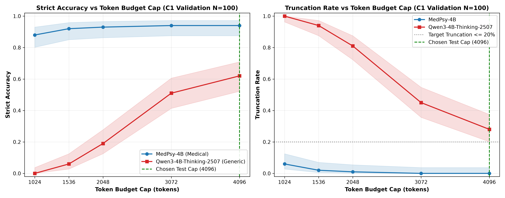

# Pair B Validation Token-Budget Sweep Report

**Models:** `medpsy-4b` (Medical SLM) vs `qwen3-4b-thinking-2507` (Generic Reasoning Control)
**Dataset:** MedQA validation split (first 100 questions in file order)
**Condition:** Condition C1 (closed-book baseline)
**Decoding:** Strictly greedy (`do_sample=False`), one run at `max_new_tokens=4096`

> [!NOTE]
> **Mathematical Derivation Validity:**
> This one-run-gives-all-caps derivation is mathematically valid **ONLY for greedy decoding** (`do_sample=False`).
> Under greedy autoregressive decoding, token selection at step $t$ is deterministic and independent of the horizon cap.
> Thus, the prefix sequence generated at any cap $c \in \{1024, 1536, 2048, 3072\}$ is identical to the first $c$ tokens of the 4096-token run.

## 1. Decision Rule Execution & Selected Test Cap

**Pre-Registered Decision Rule:** Select the smallest cap in $[1024, 1536, 2048, 3072, 4096]$ at which `qwen3-4b-thinking-2507` validation truncation $\le 20.0\%$. If none qualifies, fall back to 4096.

- **Chosen Test Cap:** `4096` tokens
- **Rule Outcome:** Cap 4096 FALLBACK SELECTED: No cap achieved truncation <= 20.0%. Residual truncation at 4096 tokens is 28.0%, which is reported as a methodological budget limitation, not as parity.
- **Equal Budget Application:** Both `medpsy-4b` and `qwen3-4b-thinking-2507` will receive cap `4096` in the final Pair B test run.

## 2. Token Generation Summary Across Full Generation (Cap=4096)

| Model | Median Tokens | p90 Tokens | Min Tokens | Max Tokens | Finished Naturally (%) |
|---|---|---|---|---|---|
| `medpsy-4b` | 510.0 | 851.3 | 218 | 2196 | 100.0% |
| `qwen3-4b-thinking-2507` | 2757.5 | 4096.0 | 1336 | 4096 | 72.0% |

## 3. Cap Grid Evaluation: Strict Accuracy & Truncation Rate

Strict accuracy requires: finished naturally within cap $c$, parsed successfully, and correct. Truncated or unparsed responses count as incorrect (0.0).

| Cap | Model | Strict Accuracy (95% CI) | Truncation Rate (95% CI) | Loop Suspect Share (Truncated) |
|---|---|---|---|---|
| 1024 | `medpsy-4b` | 88.0% [80.2%, 93.0%] | 6.0% [2.8%, 12.5%] | 0.0% (6 trunc) |
| 1024 | `qwen3-4b-thinking-2507` | 0.0% [0.0%, 3.7%] | 100.0% [96.3%, 100.0%] | 0.0% (100 trunc) |
| 1536 | `medpsy-4b` | 92.0% [85.0%, 95.9%] | 2.0% [0.6%, 7.0%] | 0.0% (2 trunc) |
| 1536 | `qwen3-4b-thinking-2507` | 6.0% [2.8%, 12.5%] | 94.0% [87.5%, 97.2%] | 0.0% (94 trunc) |
| 2048 | `medpsy-4b` | 93.0% [86.3%, 96.6%] | 1.0% [0.2%, 5.4%] | 0.0% (1 trunc) |
| 2048 | `qwen3-4b-thinking-2507` | 19.0% [12.5%, 27.8%] | 81.0% [72.2%, 87.5%] | 0.0% (81 trunc) |
| 3072 | `medpsy-4b` | 94.0% [87.5%, 97.2%] | 0.0% [0.0%, 3.7%] | 0.0% (0 trunc) |
| 3072 | `qwen3-4b-thinking-2507` | 51.0% [41.3%, 60.6%] | 45.0% [35.6%, 54.8%] | 0.0% (45 trunc) |
| 4096 | `medpsy-4b` | 94.0% [87.5%, 97.2%] | 0.0% [0.0%, 3.7%] | 0.0% (0 trunc) |
| 4096 | `qwen3-4b-thinking-2507` | 62.0% [52.2%, 70.9%] | 28.0% [20.1%, 37.5%] | 0.0% (28 trunc) |

## 4. Paired Model Comparison (MedPsy-4B minus Qwen3-4B-Thinking)

> [!NOTE]
> **Holm Family Specification:**
> A single family of 10 hypothesis tests is evaluated across the 5 caps (5 strict accuracy differences + 5 truncation rate differences).
> Both raw two-sided McNemar exact p-values and Holm-adjusted p-values are reported.

| Cap | Metric | MedPsy - Qwen Diff | Paired Bootstrap 95% CI | Discordant (b / c) | Raw McNemar p | Holm-Adjusted p |
|---|---|---|---|---|---|---|
| 1024 | Strict Accuracy | +88.0% | [+81.0%, +94.0%] | b=88, c=0 | 0.0000 | 0.0000 |
| 1024 | Truncation Rate | -94.0% | [-98.0%, -89.0%] | b=0, c=94 | 0.0000 | 0.0000 |
| 1536 | Strict Accuracy | +86.0% | [+79.0%, +92.0%] | b=86, c=0 | 0.0000 | 0.0000 |
| 1536 | Truncation Rate | -92.0% | [-97.0%, -86.0%] | b=0, c=92 | 0.0000 | 0.0000 |
| 2048 | Strict Accuracy | +74.0% | [+65.0%, +82.0%] | b=74, c=0 | 0.0000 | 0.0000 |
| 2048 | Truncation Rate | -80.0% | [-87.0%, -72.0%] | b=0, c=80 | 0.0000 | 0.0000 |
| 3072 | Strict Accuracy | +43.0% | [+32.0%, +53.0%] | b=45, c=2 | 0.0000 | 0.0000 |
| 3072 | Truncation Rate | -45.0% | [-55.0%, -35.0%] | b=0, c=45 | 0.0000 | 0.0000 |
| 4096 | Strict Accuracy | +32.0% | [+22.0%, +42.0%] | b=34, c=2 | 0.0000 | 0.0000 |
| 4096 | Truncation Rate | -28.0% | [-37.0%, -19.0%] | b=0, c=28 | 0.0000 | 0.0000 |

## 5. Descriptive Finished-Only Subset (Non-Comparative Diagnostic)

> [!IMPORTANT]
> **DESCRIPTIVE, selected subset:**
> Accuracies reported below are computed strictly on the subset of questions where **both models finished naturally within cap $c$**.
> This is conditioned on post-treatment survival and is subject to selection bias; it is presented purely as a diagnostic of reasoning quality when unconstrained.

| Cap | Both Finished N (%) | MedPsy-4B Acc (Subset) | Qwen3-4B Acc (Subset) |
|---|---|---|---|
| 1024 | 0/100 (0.0%) | 0.0% | 0.0% |
| 1536 | 6/100 (6.0%) | 100.0% | 100.0% |
| 2048 | 19/100 (19.0%) | 100.0% | 100.0% |
| 3072 | 55/100 (55.0%) | 94.5% | 92.7% |
| 4096 | 72/100 (72.0%) | 95.8% | 86.1% |

## 6. MedPsy-4B Validation Consistency Diagnostic

- **Reference File:** `/Users/satyasainathteeparthi/Documents/MTECH/Phase 1 Medrag/medrag-slm/outputs/sc_val/medpsy-4b/medqa.jsonl` (greedy column)
- **Evaluated Subset:** MedPsy-4B questions that finished within 1,024 tokens and overlap with `sc_val`
- **Overlapping Rows:** 94
- **Exact Predicted-Answer Agreement:** 94/94 (100.0%)

## 7. Visualisations

